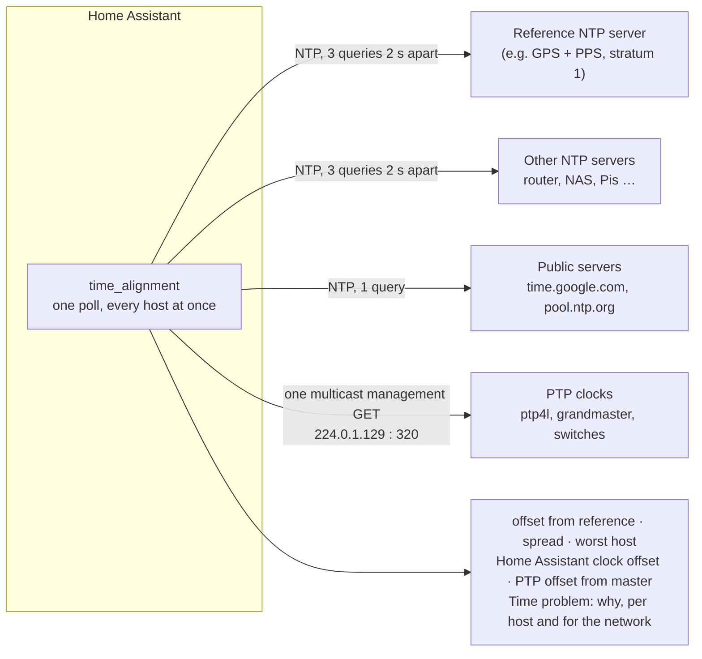

# Time Alignment (NTP/PTP) for Home Assistant

A Home Assistant integration that measures how closely the clocks on your network agree —
querying NTP servers and discovering PTP (IEEE 1588) clocks — and turns the answer into
sensors and **Time problem** flags.



## Why

Every clock on a network says it is right. The usual tools (`chronyc tracking`,
`ntpq -p`, `pmc`) each tell you how *one* machine thinks it is doing, on that machine.
This integration asks all of them at once, from one place, and compares them — so a
router that drifted, a time server that lost its GPS fix, a PTP segment that split in two
or the Home Assistant host's own clock running slow shows up as a sensor you can graph and
an alert you can automate on.

## What it does

### NTP

You list the servers to watch and pick one as the **reference** — ideally your best clock,
such as a GPS-disciplined stratum-1 server.

- Every host is measured in the **same poll**, so each offset is taken against the same
  instant of Home Assistant's own clock. Subtracting the reference's offset cancels Home
  Assistant's error exactly, leaving **host minus reference** — a figure that is right even
  when the machine running Home Assistant is the worst clock on the network.
- That same subtraction yields **Home Assistant's own clock error** as a sensor. This is
  often the only way to see it: a machine that runs a time *client* answers no NTP queries.
- **Only a synchronised host can be the reference.** If the reference stops answering or
  reports itself unsynchronised (leap indicator 3, stratum 16), the median of the
  synchronised hosts stands in, and a `basis` attribute says which one is in use.
- **Out of tolerance means beyond it by more than the measurement can resolve.** An NTP
  offset is only known to within half the round trip, so a host is flagged only when its
  offset exceeds the tolerance by more than that bound (shown as `uncertainty_ms`). An
  internet server 30 ms away does not flap in and out of a 10 ms tolerance on path noise.
- **It is gentle with other people's servers.** A host on a private address gets three
  queries 2 s apart and the cleanest is kept; a public server gets one query per poll. The
  default poll is 5 minutes and the fastest allowed is 1 minute. A refusal
  (kiss-o'-death, e.g. `RATE`) is reported as such and stops further queries that poll.

### PTP

Turn PTP on and there is nothing else to configure: one IEEE 1588 **management GET** sent
to the PTP multicast group is answered by every PTP clock that hears it (the same request
`pmc -4 'GET CURRENT_DATA_SET'` sends), so every clock on the segment is discovered and
gets its own device.

- Per clock: offset from master, mean path delay, steps removed, port state, grandmaster
  identity and clock class.
- A clock is a problem if any of its ports is faulty, disabled, listening or
  uncalibrated, if its offset exceeds the PTP tolerance, or if it has lost its
  grandmaster.
- The network is a problem if the clocks report **more than one grandmaster** — the
  segment has split, and the halves are drifting apart while each looks healthy.

### Entities

| Device | Sensors | Problem sensor reasons |
| --- | --- | --- |
| **Network time** | offset spread, worst offset (and which host), hosts with problems, Home Assistant clock offset; with PTP: clocks seen, worst PTP offset | every reason below, prefixed with the host or clock |
| **each NTP server** | offset, offset from reference, round trip, root distance, stratum, upstream reference | `unreachable` (with the error), `unsynchronised`, `out_of_tolerance` |
| **each PTP clock** | offset from master, mean path delay, steps removed, port state, grandmaster, grandmaster clock class | `port_<n>_<state>`, `offset_out_of_tolerance`, `no_grandmaster`, `not_answering` |

*Root distance* is `root_delay / 2 + root_dispersion`: the server's own bound on its error
against UTC.

## Requirements

- Home Assistant **2026.8** or later.
- NTP: any server that answers a standard NTPv4 client request — chrony, ntpd, NTPsec,
  router firmware, appliance time servers, public pools.
- PTP: clocks that answer IEEE 1588 management messages over UDP/IPv4, such as `ptp4l`
  (linuxptp).

## Install

### HACS

1. HACS → three-dot menu → **Custom repositories**
2. Add this repository, category **Integration**
3. Install **Time Alignment (NTP/PTP)**, then restart Home Assistant

### Manual

Copy `custom_components/time_alignment` into your `config/custom_components/` directory
and restart Home Assistant.

## Setup

**Settings → Devices & services → Add integration → Time Alignment.** One entry watches the
whole network (the network-wide figures only mean something when every host is measured
in the same poll), and everything can be changed later under **Configure**.

| Option | Default | |
| --- | --- | --- |
| NTP hosts | — | one per line or comma-separated; `host`, `host:port`, `[ipv6]:port` |
| Reference | median | must be one of the hosts |
| Tolerance | 10 ms | |
| Poll interval | 300 s | at least 60 s |
| PTP | off | |
| PTP domain | 0 | must match your clocks' `domainNumber` |
| PTP interface address | any | the local IPv4 address to join the multicast group on |
| PTP tolerance | 1 µs | |

Hosts are not probed when you save: a host that is down today is still one to watch, and
its being down is what its problem sensor reports.

### Things to know

- **A machine running only a time client cannot be measured** — it does not answer NTP.
  For chrony, an `allow` line makes it serve (and so measurable).
- **PTP needs UDP port 320** and the PTP multicast group. That port is privileged, so Home
  Assistant must run as root (it does in the official container and OS) and see the LAN
  directly (host networking). If it cannot bind, the **PTP clocks seen** sensor's `error`
  attribute says why.
- **Only PTP over UDP/IPv4 is seen.** `ptp4l` with `network_transport L2` or `UDPv6`, and
  802.1AS (gPTP, Ethernet only), do not answer this client.
- A PTP clock that stops answering keeps its device, reading `not_answering`, until you
  delete it from its device page. Removing an NTP host in the options removes its device.

## Checking servers from the command line

`tools/probe.py` runs the same measurement code outside Home Assistant (it needs only
`pip install ntplib`):

```bash
python3 tools/probe.py --reference ntp1.example ntp1.example router.example time.google.com
python3 tools/probe.py --ptp            # also sweep PTP; needs root for UDP 320
```

## Tests

```bash
pip install pytest-homeassistant-custom-component ntplib
python -m pytest -q
```

The protocol tests use a fake NTP server and a fake `ptp4l` over loopback; the PTP encoder
is checked against byte strings written out field by field from linuxptp's own structs.

## Layout

| Path | |
| --- | --- |
| `custom_components/time_alignment/ntp.py` | NTP query, burst policy and the figures that judge a sample |
| `custom_components/time_alignment/ptp.py` | IEEE 1588 management client: encoder, decoder, discovery, problems |
| `custom_components/time_alignment/alignment.py` | the arithmetic: basis, offsets, spread, uncertainty, tolerance |
| `custom_components/time_alignment/coordinator.py` | one poll: every NTP host and the PTP sweep, concurrently |
| `custom_components/time_alignment/*.py` (rest) | Home Assistant glue: config flow, devices, sensors |
| `tests/` | protocol, arithmetic and in-Home-Assistant tests |
| `tools/probe.py` | the same code from the command line |
| `tools/make_icon.py` | draws the brand icon |

## License

MIT — see [LICENSE](LICENSE).
